# LOMBA UI/UX - Design Competition Project

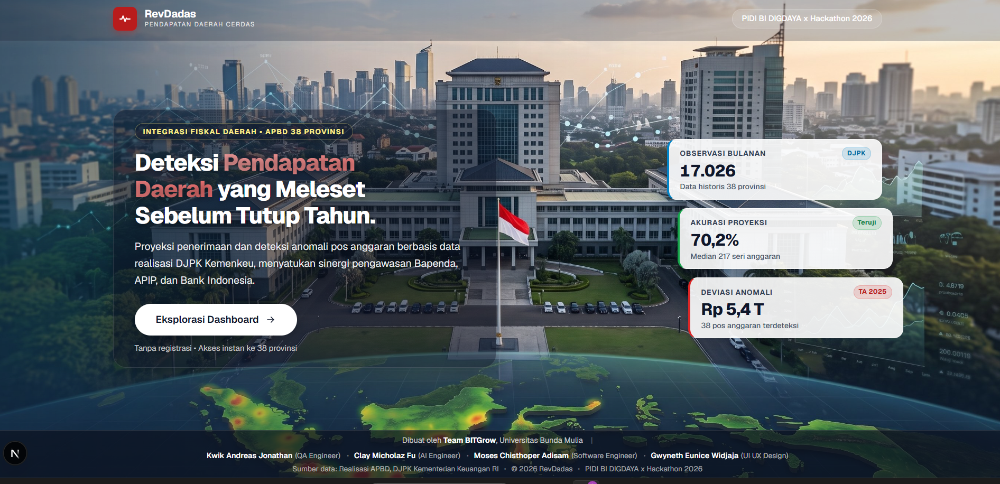

## Links
- **Figma Prototype**: [View Interactive Prototype](https://www.figma.com/proto/cjHyvPY0fDPUx4mWoR0VNS/LOMBA-UI-UX?node-id=1-2&t=TV73cfoPXysihlDG-1&scaling=scale-down&content-scaling=fixed&page-id=0%3A1&starting-point-node-id=1%3A2)
- **Figma File**: [View Design File](https://www.figma.com/design/cjHyvPY0fDPUx4mWoR0VNS/LOMBA-UI-UX)

## Project Overview

Project ini dibuat untuk mengikuti lomba UI/UX design. Design ini mencakup full user flow dari aplikasi/website dengan fokus pada user experience dan visual design yang clean dan modern.

**Collaboration**: This project was created in collaboration with Corinthia Angie.

## Project Details

- **Type**: Competition Project
- **Role**: UI/UX Designer (Collaborative Work)
- **Collaborator**: Corinthia Angie
- **Tools Used**: Figma
- **Duration**: Academic Project 2026
- **Target SDG**: SDG 11 (Sustainable Cities), SDG 12 (Responsible Consumption), SDG 13 (Climate Action)

## Problem Statement

Pejalan kaki di area perkotaan menghadapi tantangan besar terkait:

- **Keamanan Rute**: Minimnya informasi jalur aman dari tindak kejahatan dan infrastruktur yang rusak
- **Infrastruktur Buruk**: Trotoar rusak, lampu jalan mati, dan fasilitas publik tidak terawat
- **Sistem Pelaporan Tidak Efisien**: Alur birokrasi pelaporan kerusakan infrastruktur tidak transparan dan memakan waktu lama
- **Kurangnya Keterlibatan Masyarakat**: Partisipasi warga dalam menjaga keberlanjutan lingkungan masih pasif
- **Tanggap Darurat Lambat**: Sistem darurat konvensional memakan waktu saat panik dan tidak membagikan lokasi secara real-time

Target pengguna utama adalah pejalan kaki perkotaan yang membutuhkan rute aman, pemerintah daerah yang memerlukan data kerusakan infrastruktur akurat, dan mitra lingkungan yang mengelola program daur ulang.

## What I Did

### Research & Discovery
- Conducted user research to understand user needs and pain points
- Analyzed competitor apps to identify gaps and opportunities
- Created user personas and journey maps
- Identified key user goals and frustrations

### Design Solution
- Designed intuitive user interface with focus on usability
- Created consistent design system with reusable components
- Developed information architecture for easy navigation
- Ensured responsive design for multiple screen sizes

### Prototyping & Testing
- Built interactive prototype in Figma
- Conducted usability testing with potential users
- Iterated design based on feedback
- Refined user flows for better experience

## Design Process

### 1. Research & Analysis
- User interviews and surveys
- Competitor analysis
- Market research
- Problem identification and validation

### 2. Ideation & Wireframing
- Brainstorming sessions
- User flow mapping
- Low-fidelity wireframes
- Information architecture design

### 3. Visual Design
- Color palette selection based on brand identity
- Typography hierarchy and choices
- Component library creation
- UI consistency across all screens

### 4. Prototyping & Testing
- Interactive prototype creation in Figma
- User flow testing with real users
- Feedback collection and analysis
- Design iteration and refinement

## Solution

AWAS (Always Walking And Safe) adalah aplikasi mobile terintegrasi yang menyelaraskan kebutuhan keamanan, pelaporan publik (G2C), dan gamifikasi gaya hidup berkelanjutan untuk mendukung SDG 11, 12, dan 13.

**Solusi yang Ditawarkan:**

- **Sistem Keamanan Real-Time**: Tombol SOS darurat dengan pengiriman lokasi instan via WebSocket, fitur Fake Call untuk distraksi, dan pencarian Hero Nearby (relawan terdekat)
- **Pelaporan Terstruktur**: Portal G2C dengan geotagging otomatis yang langsung terhubung ke dashboard pemerintah kota
- **Navigasi AR Interaktif**: AWAS Lens menggunakan Augmented Reality untuk proyeksi rute aman secara visual real-time
- **Gamifikasi Lingkungan**: Sistem Green Points untuk reward daur ulang sampah, step tracker, eco-quiz, dan pemetaan Eco-Spots

**Value Proposition:**
- Mengurangi tingkat kecemasan pejalan kaki di ruang publik
- Mempercepat penyelesaian laporan perbaikan fasilitas kota
- Meningkatkan partisipasi warga dalam ekosistem lingkungan berkelanjutan
- Menyediakan data infrastruktur terstruktur dengan koordinat presisi tinggi

## Key Features

1. **Safety Center (Guard Center)**
   - SOS Button dengan transmisi lokasi real-time tanpa jeda
   - Fake Call untuk simulasi panggilan pengalih saat terancam
   - Hero Nearby untuk mencari relawan terdekat dalam radius lokasi
   - Manajemen kontak darurat terenkripsi

2. **Live Report (G2C Portal)**
   - Pelaporan infrastruktur rusak dengan geotagging otomatis
   - Upload foto bukti langsung dari kamera (anti-spam)
   - Dashboard tracking status laporan transparan
   - Integrasi langsung ke sistem pemerintah kota

3. **Discover (Gamifikasi)**
   - Step Tracker untuk pencatatan langkah kaki harian
   - Green Points reward system untuk aktivitas berkelanjutan
   - Eco-Quiz interaktif untuk edukasi lingkungan
   - Pemetaan Eco-Spots (Bank Sampah, UMKM ramah lingkungan)
   - Quest system dan donation feature

4. **AWAS Lens (AR Camera)**
   - Navigasi augmented reality dengan overlay petunjuk arah visual
   - Penanda zona bahaya dan zona aman real-time
   - Visualisasi lokasi Eco-Spot terdekat
   - Informasi kondisi jalan dan cuaca

5. **Impact Center**
   - Profil personal dengan badge pencapaian
   - Histori kontribusi lingkungan
   - Loyalty card digital (Bronze/Silver/Gold tier)
   - Statistik dampak ekologis personal

## Potential Improvements

### Short-term
- **Widget Darurat Lock Screen**: Akses kilat SOS dan Fake Call tanpa unlock perangkat
- **Offline Mode Enhancement**: Sinkronisasi data otomatis saat koneksi kembali tersedia
- **Dark Mode**: Tema gelap untuk penggunaan malam hari dan hemat baterai
- **Multi-language Support**: Ekspansi ke bahasa daerah untuk inklusivitas lebih luas

### Long-term
- **AI Computer Vision**: Deteksi otomatis kerusakan jalan via kamera tanpa input manual
- **Predictive Analytics**: Prediksi zona rawan kejahatan berdasarkan data historis
- **Smart Routing Algorithm**: Optimasi rute berdasarkan preferensi (teraman/tercepat/paling hijau)
- **API Donasi Nasional**: Konversi Green Points menjadi aksi penanaman pohon fisik

### Based on Architecture & Testing
- **Multi-region Cloud Deployment**: Auto-failover untuk menjaga uptime 99.9% saat darurat
- **Enhanced Spam Detection**: Algoritma ML untuk filter laporan palsu lebih akurat
- **Voice Command Integration**: Aktivasi SOS dengan perintah suara hands-free
- **Community Moderation**: Sistem voting dan verifikasi laporan oleh komunitas lokal

## Screenshots

### Main Screens

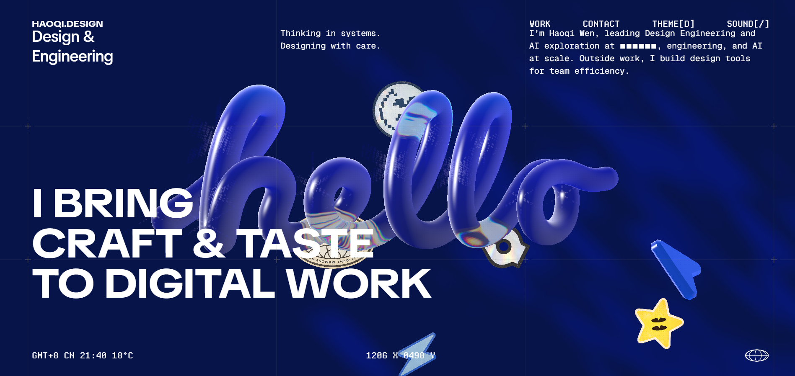
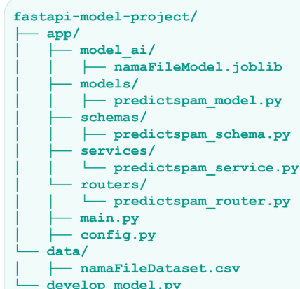
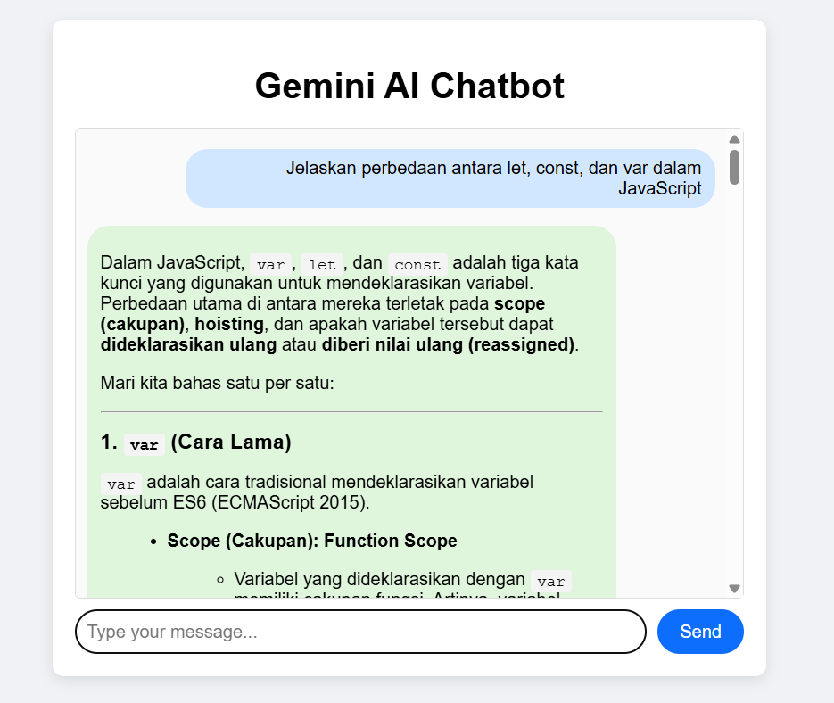

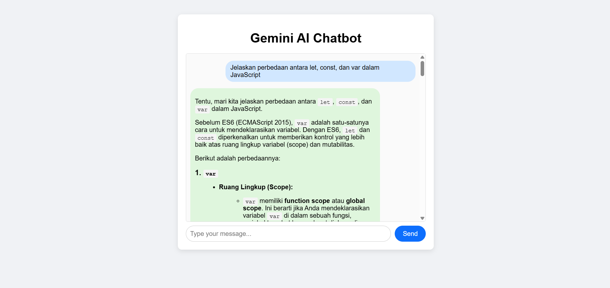
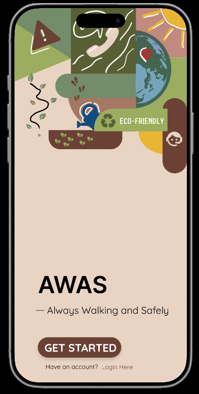
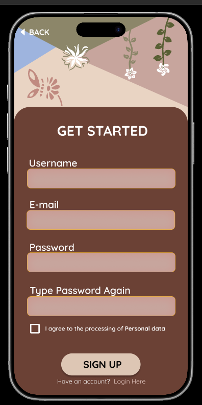

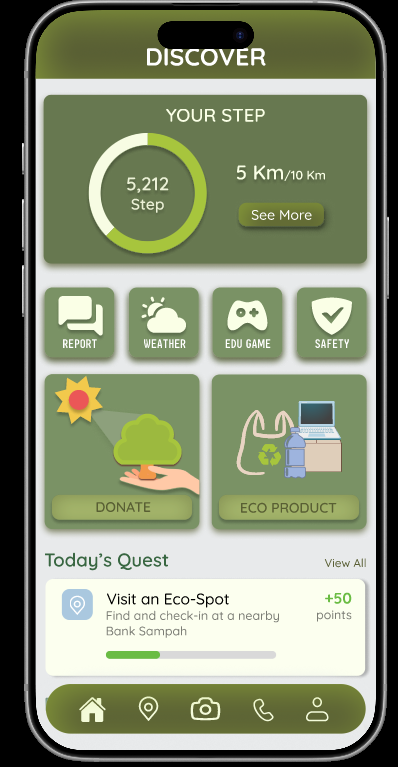
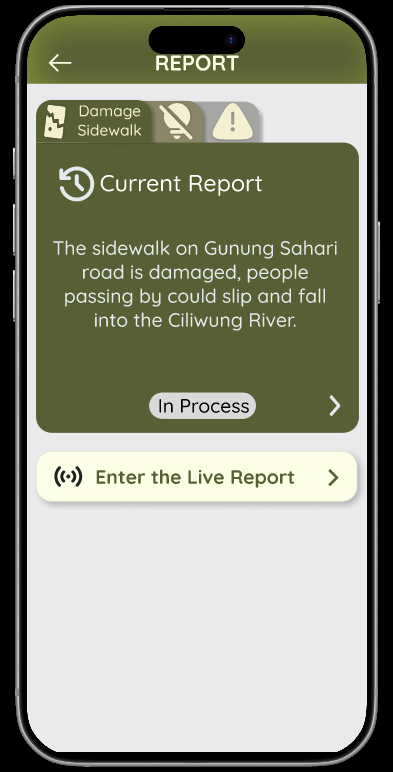
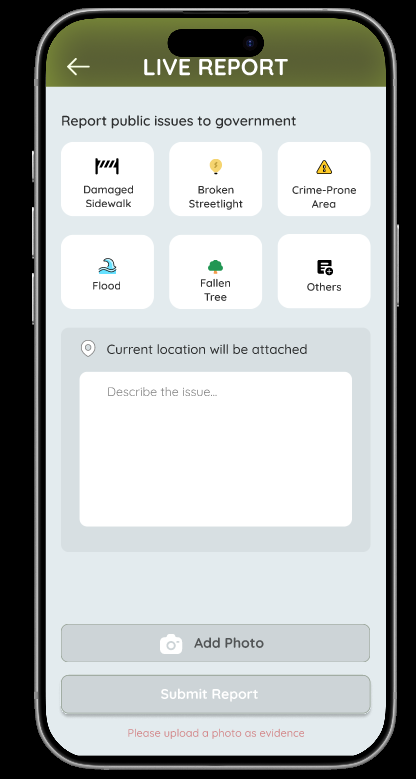

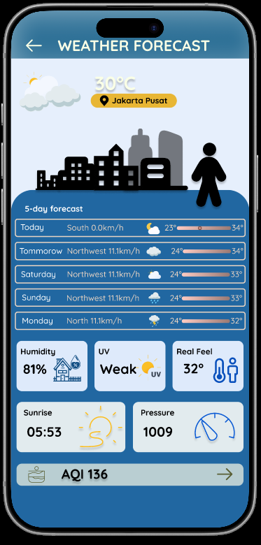
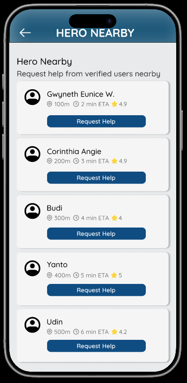
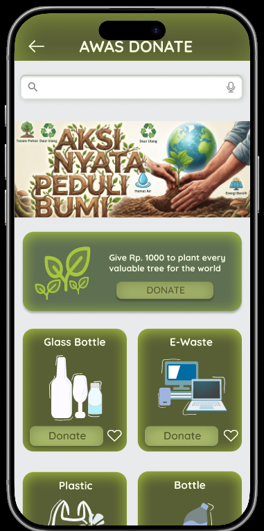

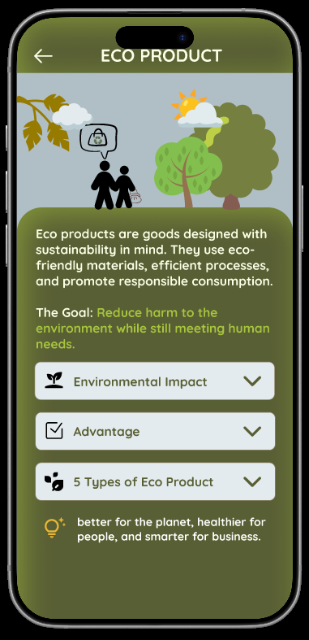
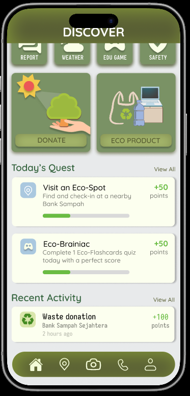
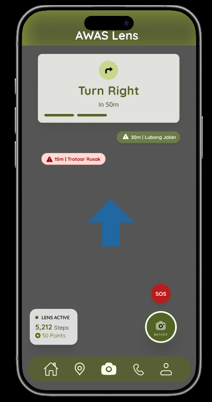

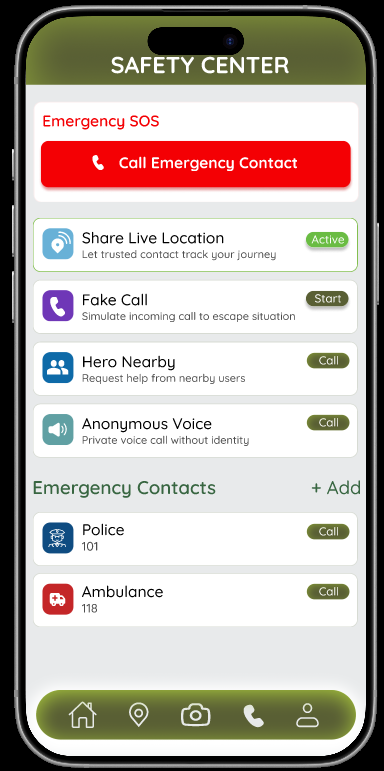
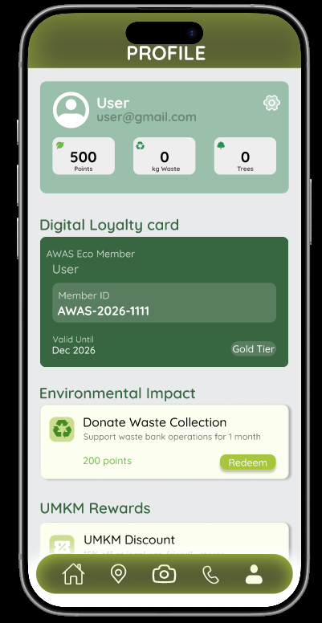

---

## Contact

- **LinkedIn**: [Gwyneth Eunice W](https://www.linkedin.com/in/gwyneth-eunice-w-508322406/)
- **GitHub**: [@ggwyniebtw](https://github.com/ggwyniebtw)

---

**Project Status**: Completed

**Last Updated**: October 28, 2026
